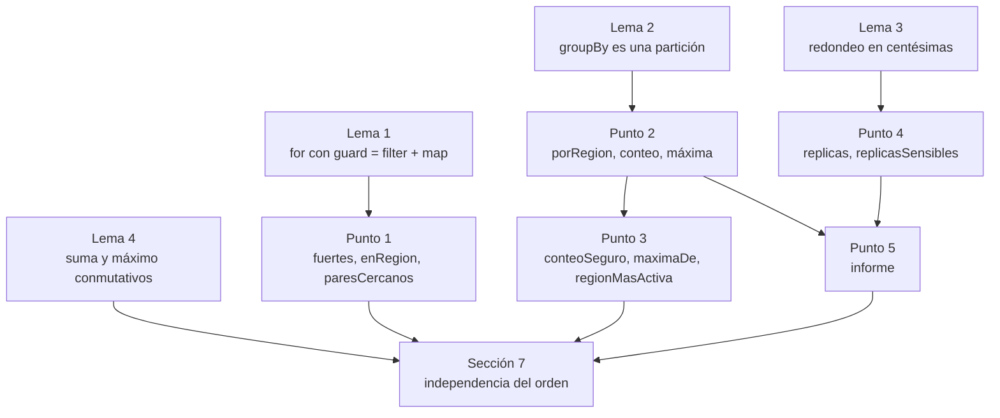
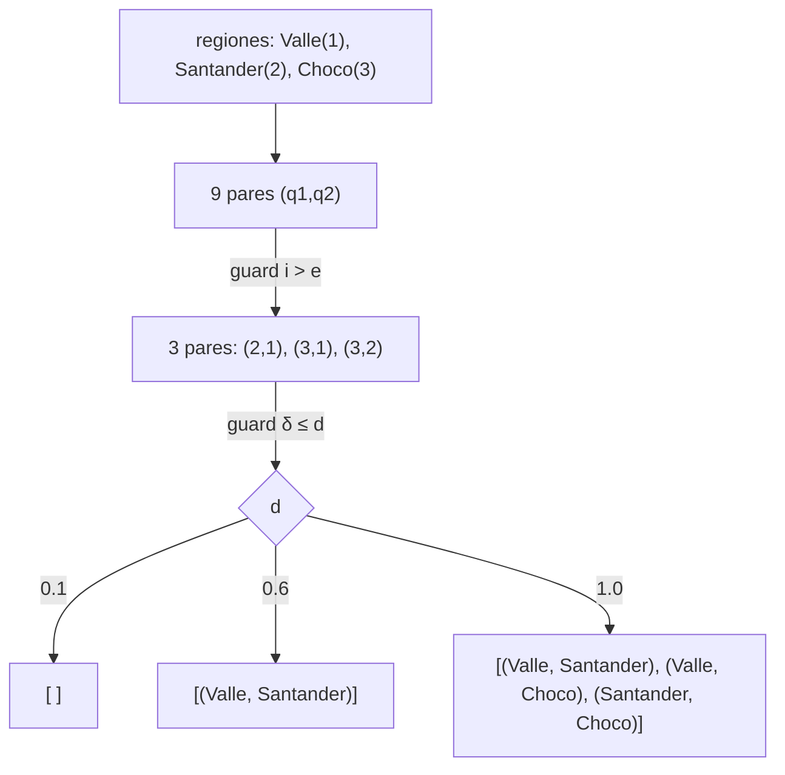
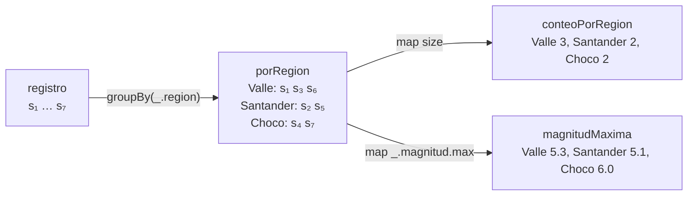
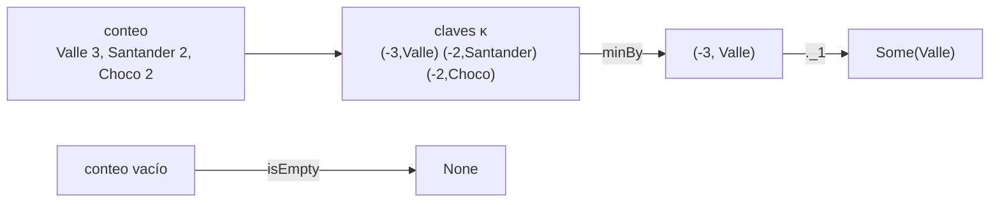
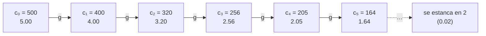
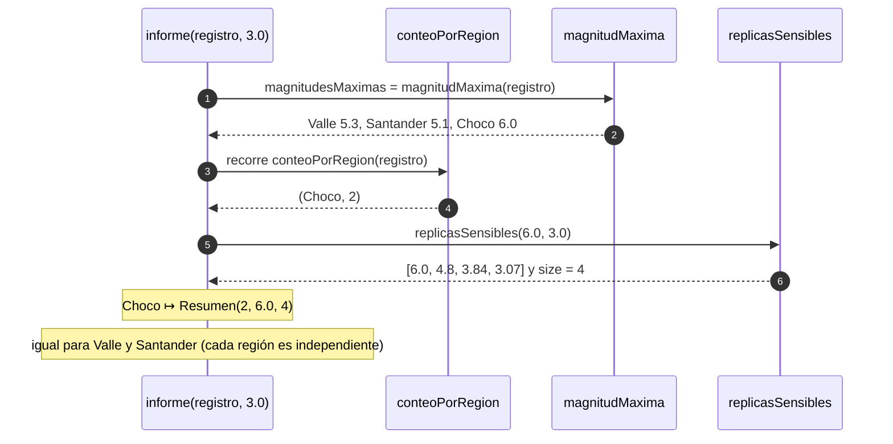
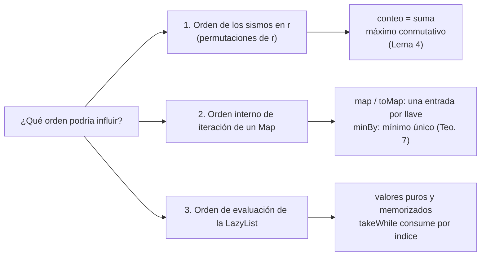
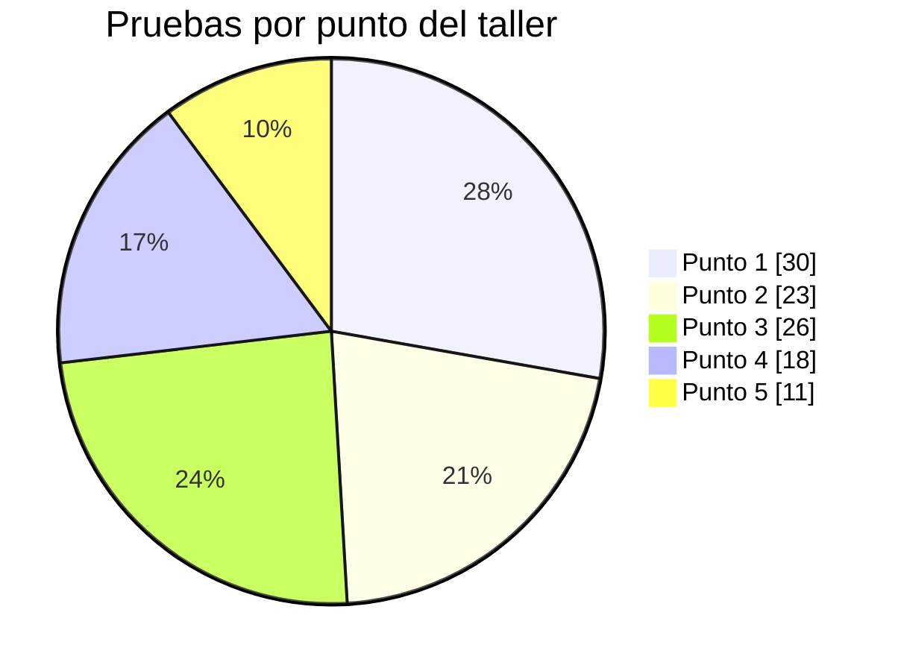

# Informe de corrección — Taller 3: registro sísmico con `for`, mapas y secuencias perezosas

Este informe demuestra, con notación matemática, que cada función de `RegistroSismico` cumple su especificación, explica cómo se encadenan los cálculos durante la ejecución y argumenta por qué **el resultado no depende del orden de recorrido**. Complementa a `informe_proceso.md`, que muestra la ejecución paso a paso.

## Contenido

0. [Notación y convenciones](#0-notación-y-convenciones)
1. [Lemas básicos](#1-lemas-básicos)
2. [Punto 1: `fuertes`, `enRegion` y `paresCercanos`](#2-punto-1-fuertes-enregion-y-paresercanos)
3. [Punto 2: `porRegion`, `conteoPorRegion` y `magnitudMaxima`](#3-punto-2-porregion-conteoporregion-y-magnitudmaxima)
4. [Punto 3: `conteoSeguro`, `maximaDe` y `regionMasActiva`](#4-punto-3-conteoseguro-maximade-y-regionmasactiva)
5. [Punto 4: `replicas` y `replicasSensibles`](#5-punto-4-replicas-y-replicassensibles)
6. [Punto 5: `informe`](#6-punto-5-informe)
7. [Independencia del orden de recorrido](#7-independencia-del-orden-de-recorrido)
8. [Casos de prueba y propiedades](#8-casos-de-prueba-y-propiedades)
9. [Alcance y precondiciones](#9-alcance-y-precondiciones)

---

## 0. Notación y convenciones

Sea $r=[s_1,\dots,s_n]$ un registro de $n\ge 0$ sismos.

| Símbolo | Significado |
|---|---|
| $\operatorname{reg}(s)$, $\operatorname{mag}(s)$ | Región y magnitud del sismo $s$ |
| $[\,]$ | Lista vacía (`List()`) |
| $s::t$ | Lista con cabeza $s$ y cola $t$ |
| $\mathcal{G}(r)=\{\operatorname{reg}(s_i)\mid 1\le i\le n\}$ | Regiones presentes en $r$ |
| $[g_1,\dots,g_k]$ | Regiones sin repetir, en orden de **primera aparición** (`distinct`) |
| $r_g=[\,s_i\mid\operatorname{reg}(s_i)=g\,]$ | Sismos de la región $g$, conservando el orden de $r$ |
| $M_g=[\operatorname{mag}(s)\mid s\in r_g]$ | Lista de magnitudes de la región $g$ |
| $C(g)=\lvert r_g\rvert$ | Cantidad de sismos de $g$ |
| $M(g)=\max M_g$ | Magnitud máxima de $g$ |
| $\delta(a,b)=\min\{\lvert x-y\rvert : x\in M_a,\ y\in M_b\}$ | Mínima distancia entre magnitudes de dos regiones |
| $\rho(x)=\lfloor 100x+\tfrac12\rfloor/100$ | Redondeo a dos decimales (`Math.round(x*100.0)/100.0`) |
| $[\,P\,]$ | Vale 1 si $P$ es cierta y 0 si no |

**Método de demostración.** Las funciones definidas con `for` se reducen a `withFilter`/`map`/`flatMap`, cuya semántica se fija con recursión sobre la lista (Lema 1) y se verifica por **inducción estructural**. Las funciones sobre mapas se verifican con el Lema 2 (partición). La secuencia perezosa se verifica sobre enteros de centésimas (Lema 3). La independencia del orden se prueba con conmutatividad de la suma y del máximo (Lema 4) y con la unicidad del mínimo.

**Hipótesis del modelo.**

- **H1.** Las operaciones sobre `Double` se razonan en aritmética exacta. Los casos de prueba verifican los valores concretos en `Double` (por ejemplo, $0.8\cdot 3.2=2.5600000000000005$ se redondea a $2.56$).
- **H2.** Los nombres de región se comparan con `==` (distingue mayúsculas) y se ordenan con el orden natural de `String`.
- **H3.** Las magnitudes son números no negativos.

**Mapa del informe.**



---

## 1. Lemas básicos

### Lema 1 (un `for` con guard es `filter` seguido de `map`)

Sean $p$ un predicado, $f$ una función y $r$ una lista. Definimos

$$
\operatorname{FM}(p,f,[\,])=[\,],\qquad
\operatorname{FM}(p,f,s::t)=
\begin{cases}
f(s)::\operatorname{FM}(p,f,t) & p(s)\\
\operatorname{FM}(p,f,t) & \neg p(s)
\end{cases}
$$

Entonces `r.withFilter(p).map(f)` $=\operatorname{FM}(p,f,r)=[\,f(s_i)\mid 1\le i\le n,\ p(s_i)\,]$.

**Demostración.** Por inducción sobre $\ell(r)$.

- *Base* ($r=[\,]$): filtrar y mapear una lista vacía da $[\,]$.
- *Paso* ($r=s::t$, con la hipótesis para $t$). Si $p(s)$, el filtro conserva $s$ y deja $s::\operatorname{filter}(p)(t)$; al aplicar `map` queda $f(s)::\operatorname{FM}(p,f,t)$. Si $\neg p(s)$, el filtro descarta $s$ y queda $\operatorname{FM}(p,f,t)$. En ambos casos coincide con la definición. $\blacksquare$

El compilador traduce `for { x <- xs; if p(x) } yield f(x)` a `xs.withFilter(p).map(f)`. Con dos generadores, `for { x <- xs; y <- ys } yield e` se traduce a `xs.flatMap(x => ys.map(y => e))`.

### Lema 2 (partición de `groupBy`)

`r.groupBy(_.region)` es el mapa $\{g\mapsto r_g\mid g\in\mathcal{G}(r)\}$ y además:

$$
\sum_{g\in\mathcal{G}(r)}\lvert r_g\rvert=n\qquad\text{y}\qquad r_g\ne\emptyset\ \ \forall g\in\mathcal{G}(r)
$$

**Demostración.** Cada sismo tiene exactamente una región, así que pertenece a un único $r_g$: los $r_g$ son disjuntos y su unión es $r$, de donde la suma da $n$. Si $g\in\mathcal{G}(r)$, algún $s_i$ tiene región $g$, por lo que $r_g\ne\emptyset$. Dentro de cada $r_g$ los sismos conservan el orden relativo de $r$ (así lo define `groupBy`). $\blacksquare$

### Lema 3 (el redondeo en centésimas)

Sea $c_k=100\,s_k\in\mathbb{N}$ el valor de una réplica expresado en centésimas. Como $\rho$ es el redondeo $\lfloor x+\tfrac12\rfloor$ sobre centésimas, un paso de la recurrencia $s\mapsto\rho(0.8\,s)$ es

$$
g(c)=\Big\lfloor\frac{8c+5}{10}\Big\rfloor
$$

Entonces:

1. $g$ es no decreciente.
2. $g(c)<c$ para todo $c\ge 3$.
3. $g(0)=0,\ g(1)=1,\ g(2)=2$.
4. $g(c)\ge 2$ para todo $c\ge 3$.
5. $\rho$ es idempotente: $\rho(\rho(x))=\rho(x)$.

**Demostración.**
(1) $c\mapsto(8c+5)/10$ es creciente y $\lfloor\cdot\rfloor$ es no decreciente.
(2) $g(c)\le(8c+5)/10<c\iff 5<2c\iff c\ge 3$.
(3) $\lfloor 0.5\rfloor=0$, $\lfloor1.3\rfloor=1$, $\lfloor2.1\rfloor=2$.
(4) $g(3)=\lfloor 2.9\rfloor=2$ y $g$ es no decreciente.
(5) $\rho(x)$ ya es múltiplo de $0.01$, y redondear un múltiplo de $0.01$ lo deja igual. $\blacksquare$

### Lema 4 (la suma y el máximo no dependen del orden)

Sea $\sigma$ una permutación de $\{1,\dots,m\}$.

1. $\sum_{i=1}^{m}a_{\sigma(i)}=\sum_{i=1}^{m}a_i$ para cualesquiera enteros $a_i$.
2. $\max\{a_{\sigma(1)},\dots,a_{\sigma(m)}\}=\max\{a_1,\dots,a_m\}$ para $m\ge1$.

**Demostración.** (1) La suma de enteros es conmutativa y asociativa. (2) Ambos miembros son el mayor elemento del **mismo conjunto** de valores; $\max$ es conmutativa, asociativa e idempotente. $\blacksquare$

---

## 2. Punto 1: `fuertes`, `enRegion` y `paresCercanos`

### 2.1 `fuertes`

**Especificación.** Las regiones de los sismos con magnitud estrictamente mayor que $u$, en orden y con repetidos:

$$
F(r,u)=\big[\operatorname{reg}(s_i)\ \big|\ 1\le i\le n,\ \operatorname{mag}(s_i)>u\big]
$$

**Teorema 1.** `fuertes(r,u)` $=F(r,u)$.

**Demostración.** El `for { p <- r; if p.magnitud > umbral } yield p.region` se traduce a `r.withFilter(p => p.magnitud > umbral).map(p => p.region)`. Por el Lema 1 con $p(s)=(\operatorname{mag}(s)>u)$ y $f=\operatorname{reg}$, es $[\operatorname{reg}(s_i)\mid \operatorname{mag}(s_i)>u]$. $\blacksquare$

**Consecuencias.**

1. **Umbral estricto:** si $\operatorname{mag}(s)=u$, entonces $\operatorname{mag}(s)>u$ es falso y $s$ no aporta.
2. **Repetidos:** no hay `distinct`, así que $\lvert F(r,u)\rvert=\#\{i\mid\operatorname{mag}(s_i)>u\}$.
3. **Bordes:** $F([\,],u)=[\,]$; si $u<\min_i\operatorname{mag}(s_i)$, entonces $\lvert F(r,u)\rvert=n$.

**Cómo se encadenan los cálculos.** Con el registro del taller y $u=5.0$ (magnitudes $4.2,5.1,3.8,6.0,4.7,5.3,3.1$), aplicando la definición recursiva de $\operatorname{FM}$:

$$
\begin{aligned}
F([s_1,\dots,s_7],5.0)&=F([s_2,\dots,s_7],5.0) &&(4.2\le5.0)\\
&=\texttt{Santander}::F([s_3,\dots,s_7],5.0) &&(5.1>5.0)\\
&=\texttt{Santander}::F([s_4,\dots,s_7],5.0) &&(3.8\le5.0)\\
&=\texttt{Santander}::\texttt{Choco}::F([s_5,s_6,s_7],5.0) &&(6.0>5.0)\\
&=\texttt{Santander}::\texttt{Choco}::F([s_6,s_7],5.0) &&(4.7\le5.0)\\
&=\texttt{Santander}::\texttt{Choco}::\texttt{Valle}::F([s_7],5.0) &&(5.3>5.0)\\
&=\texttt{Santander}::\texttt{Choco}::\texttt{Valle}::F([\,],5.0) &&(3.1\le5.0)\\
&=[\texttt{Santander},\texttt{Choco},\texttt{Valle}]
\end{aligned}
$$



```mermaid
flowchart LR
    S0["acc = [ ]"] -->|"s₁ 4.2 ≤ 5.0: salta"| S1["acc = [ ]"]
    S1 -->|"s₂ 5.1 > 5.0"| S2["acc = [Santander]"]
    S2 -->|"s₃ 3.8: salta"| S3["acc = [Santander]"]
    S3 -->|"s₄ 6.0 > 5.0"| S4["acc = [Santander, Choco]"]
    S4 -->|"s₅ 4.7: salta"| S5["acc = [Santander, Choco]"]
    S5 -->|"s₆ 5.3 > 5.0"| S6["acc = [Santander, Choco, Valle]"]
    S6 -->|"s₇ 3.1: salta"| R["resultado"]
```

### 2.2 `enRegion`

**Especificación.** $E(r,g)=[\operatorname{mag}(s_i)\mid\operatorname{reg}(s_i)=g]=\operatorname{map}(\operatorname{mag})(r_g)$.

**Teorema 2.** `enRegion(r,g)` $=E(r,g)$.

**Demostración.** Es el Lema 1 con $p(s)=(\operatorname{reg}(s)=g)$ y $f=\operatorname{mag}$. $\blacksquare$

Si $g\notin\mathcal{G}(r)$ ningún sismo pasa el filtro y el resultado es $[\,]$. Con $g=\texttt{Valle}$ en el registro del taller, pasan $s_1,s_3,s_6$ y el resultado es $[4.2,3.8,5.3]$.

### 2.3 `paresCercanos`

**Especificación.** Con $[g_1,\dots,g_k]$ las regiones por primera aparición,

$$
P(r,d)=\big[(g_e,g_i)\ \big|\ 1\le e<i\le k,\ \delta(g_e,g_i)\le d\big]
$$

recorrido con $i$ creciente y, dentro de cada $i$, con $e$ creciente.

**Implementación.** El `for` tiene dos generadores sobre `regiones.zipWithIndex`, el guard `i>e` y el guard `r.exists(...)`; se traduce a `flatMap` (generador externo), `withFilter` (guards) y `map` (que arma `(q2, q1)`). La condición `r.exists(s1 => s1.region==q1 && r.exists(s2 => s2.region==q2 && math.abs(s1.magnitud-s2.magnitud) <= dif))` dice que existen $x\in M_{q_1}$ y $y\in M_{q_2}$ con $\lvert x-y\rvert\le d$, es decir $\delta(q_1,q_2)\le d$.

**Teorema 3.** `paresCercanos(r,d)` $=P(r,d)$ y además:

- **(a) Sin autoparejas:** ninguna pareja $(a,b)$ cumple $a=b$.
- **(b) Sin duplicados ni simétricas:** si $(a,b)$ sale, $(b,a)$ no sale, y $(a,b)$ sale una sola vez.
- **(c) Corrección y completitud:** $(a,b)$ sale si y solo si $a\ne b$, $a$ aparece antes que $b$ en $r$ y $\delta(a,b)\le d$.

**Demostración.**

(a) Sólo se producen $(g_e,g_i)$ con $e<i$ y, como las regiones de $[g_1,\dots,g_k]$ son distintas (`distinct`), $g_e\ne g_i$.

(b) Cada par de índices $(i,e)$ con $e<i$ se enumera una sola vez. Dadas dos regiones distintas, sólo una asignación de índices cumple $e<i$: la que pone primero a la que apareció antes. Luego $\{a,b\}$ sale a lo sumo una vez y con esa orientación.

(c) ($\Rightarrow$) Si $(g_e,g_i)$ sale, pasó los guards: $e<i$ y $\delta(g_i,g_e)\le d$. Como $\lvert x-y\rvert=\lvert y-x\rvert$, $\delta$ es simétrica y vale $\delta(g_e,g_i)\le d$.
($\Leftarrow$) Si $a=g_e$, $b=g_i$ con $e<i$ y $\delta(a,b)\le d$, el par de índices $(i,e)$ se enumera y pasa ambos guards. $\blacksquare$

**Cómo se encadenan los cálculos.** Regiones por primera aparición: $g_1=\texttt{Valle}$, $g_2=\texttt{Santander}$, $g_3=\texttt{Choco}$. Los nueve pares $(q_1,q_2)$ del producto cartesiano se reducen, por el guard `i>e`, a tres:

| $(i,e)$ | $(g_e,g_i)$ | $\delta$ | $\le 0.1$ | $\le 0.6$ | $\le 1.0$ |
|---|---|---|---|---|---|
| $(2,1)$ | Valle, Santander | $0.2$ ($5.3$ vs $5.1$) | no | **sí** | **sí** |
| $(3,1)$ | Valle, Choco | $0.7$ ($3.8$ vs $3.1$) | no | no | **sí** |
| $(3,2)$ | Santander, Choco | $0.9$ ($5.1$ vs $6.0$) | no | no | **sí** |

De donde $P(r,0.1)=[\,]$, $P(r,0.6)=[(\texttt{Valle},\texttt{Santander})]$ y $P(r,1.0)$ contiene las tres parejas en el orden de la tabla.



**Casos especiales.** El límite es inclusivo ($\le d$): con magnitudes $4.0$ y $5.0$ y $d=1.0$ la pareja sale. Con $d<0$ ningún $\lvert x-y\rvert\ge0$ cumple $\le d$ y el resultado es $[\,]$. Con una sola región no hay pares $e<i$ y el resultado es $[\,]$.

---

## 3. Punto 2: `porRegion`, `conteoPorRegion` y `magnitudMaxima`

**Especificación.**

$$
\begin{aligned}
\text{porRegion}(r)&=\{\,g\mapsto r_g\mid g\in\mathcal{G}(r)\,\}\\
\text{conteoPorRegion}(r)&=\{\,g\mapsto C(g)\mid g\in\mathcal{G}(r)\,\}\\
\text{magnitudMaxima}(r)&=\{\,g\mapsto M(g)\mid g\in\mathcal{G}(r)\,\}
\end{aligned}
$$

**Teorema 4.** Las tres funciones cumplen su especificación, y $\sum_g C(g)=n$.

**Demostración.**

- `porRegion` es `r.groupBy(_.region)`, que por el Lema 2 es $\{g\mapsto r_g\}$.
- `conteoPorRegion` aplica `map { case (g, l) => g -> l.size }` a ese mapa. Cada pareja se transforma de forma independiente y las llaves no cambian, así que el resultado es $\{g\mapsto\lvert r_g\rvert\}=\{g\mapsto C(g)\}$. La suma es $n$ por el Lema 2.
- `magnitudMaxima` aplica `g -> l.map(_.magnitud).max`. `max` falla sobre listas vacías, pero por el Lema 2 todo $r_g$ del mapa es no vacío, así que $M(g)$ está definido para cada llave. El resultado es $\{g\mapsto M(g)\}$. $\blacksquare$

**Consecuencia.** $\operatorname{dom}(\text{conteoPorRegion}(r))=\operatorname{dom}(\text{magnitudMaxima}(r))=\mathcal{G}(r)$. Una región ausente no aparece en ninguno de los dos mapas, ni siquiera con valor 0. Con $r=[\,]$ los tres mapas son vacíos.

**Cómo se encadenan los cálculos.** Para el registro del taller:

| Región $g$ | $r_g$ | $C(g)$ | $M_g$ | $M(g)$ |
|---|---|---|---|---|
| Valle | $[s_1,s_3,s_6]$ | 3 | $[4.2,\,3.8,\,5.3]$ | 5.3 |
| Santander | $[s_2,s_5]$ | 2 | $[5.1,\,4.7]$ | 5.1 |
| Choco | $[s_4,s_7]$ | 2 | $[6.0,\,3.1]$ | 6.0 |



---

## 4. Punto 3: `conteoSeguro`, `maximaDe` y `regionMasActiva`

### 4.1 `conteoSeguro`

**Especificación.**

$$
\text{conteoSeguro}(r)(g)=
\begin{cases}
C(g) & g\in\mathcal{G}(r)\\
0 & g\notin\mathcal{G}(r)
\end{cases}
$$

**Teorema 5.** `conteoSeguro(r)` cumple la especificación para todo `String` $g$.

**Demostración.** `conteoPorRegion(r).withDefaultValue(0)` es el mapa del Teorema 4 envuelto con un valor por defecto. Para una llave presente responde su valor $C(g)$; para una ausente responde $0$ **sin insertarla** (el mapa es inmutable, así que `contains` sigue siendo falso). Es una función total. $\blacksquare$

### 4.2 `maximaDe`

**Especificación.** $\text{maximaDe}(r,g)=\text{Some}(M(g))$ si $g\in\mathcal{G}(r)$ y $\text{None}$ si no.

**Teorema 6.** `maximaDe(r,g)` cumple la especificación y nunca lanza excepción.

**Demostración.** `magnitudMaxima(r).get(g)` devuelve `Some(v)` si $g$ está en el dominio y `None` si no. Como el dominio es $\mathcal{G}(r)$ (Teorema 4), coincide con la especificación. $\blacksquare$

### 4.3 `regionMasActiva`

**Especificación.** Si $r=[\,]$, `None`. Si no, `Some(`$g^*$`)`, con

$$
c^*=\max_{g}C(g),\qquad g^*=\min\{\,g\in\mathcal{G}(r)\mid C(g)=c^*\,\}
$$

es decir, la región de mayor conteo y, en empate, la primera en orden alfabético.

**Implementación.** `conteo.minBy { case (g, c) => (-c, g) }._1`, con clave $\kappa(g)=(-C(g),\,g)$ y orden lexicográfico:

$$
(a,x)\prec(b,y)\iff a<b\ \lor\ (a=b\ \land\ x<y)
$$

**Teorema 7.** `minBy` devuelve exactamente $g^*$ y es el único mínimo.

**Demostración.**

1. $\prec$ es un orden total estricto sobre $\mathbb{Z}\times\text{String}$ (lexicográfico de dos órdenes totales).
2. $\kappa$ es inyectiva: su segunda componente es $g$ y las llaves de un mapa son distintas. Por tanto **no hay empates** y el mínimo es único.
3. Si $C(g)=c^*>C(h)$, entonces $-C(g)<-C(h)$ y $\kappa(g)\prec\kappa(h)$: el mínimo está entre las regiones con $C=c^*$.
4. Entre ellas la primera componente es la misma ($-c^*$), así que decide la segunda: el menor nombre.
5. El mapa vacío se atiende con la guarda `isEmpty`, que devuelve `None`; `minBy` (que falla sobre colecciones vacías) nunca se invoca sobre vacío. $\blacksquare$

**Cómo se encadenan los cálculos.** Para el registro del taller:

| Región | $C$ | $\kappa(g)$ |
|---|---|---|
| Valle | 3 | $(-3,\ \texttt{Valle})$ |
| Santander | 2 | $(-2,\ \texttt{Santander})$ |
| Choco | 2 | $(-2,\ \texttt{Choco})$ |

El mínimo es $(-3,\texttt{Valle})$, así que el resultado es `Some("Valle")`. Con un empate $\{\texttt{Zulia}:1,\texttt{Arauca}:1\}$ las claves son $(-1,\texttt{Zulia})$ y $(-1,\texttt{Arauca})$, y $(-1,\texttt{Arauca})\prec(-1,\texttt{Zulia})$, de modo que gana `Arauca`. Si $\{\texttt{Z}:2,\texttt{A}:1\}$, las claves son $(-2,\texttt{Z})\prec(-1,\texttt{A})$: la cantidad pesa más que el nombre.



---

## 5. Punto 4: `replicas` y `replicasSensibles`

### 5.1 `replicas`

**Definición del código.** $\text{paso}(x)=\rho(x)\ \#::\ \text{paso}(\rho(0.8\,x))$ y $\text{replicas}(m)=\text{paso}(m)$.

**Teorema 8.** Sea $s_k$ el $k$-ésimo elemento (desde $k=0$) de `replicas(m)`. Si $m$ tiene a lo sumo dos decimales (así son las magnitudes del taller, es decir $\rho(m)=m$), entonces

$$
s_0=m,\qquad s_{k+1}=\rho(0.8\,s_k)
$$

**Demostración.** Sean $x_0=m$ y $x_{k+1}=\rho(0.8\,x_k)$ los argumentos sucesivos de `paso`; entonces $s_k=\rho(x_k)$. Por la idempotencia (Lema 3.5), para $k\ge1$ resulta $s_k=\rho(\rho(0.8\,x_{k-1}))=\rho(0.8\,x_{k-1})=x_k$. Además $s_0=\rho(m)=m=x_0$. Luego $x_k=s_k$ para todo $k$, y $s_{k+1}=x_{k+1}=\rho(0.8\,x_k)=\rho(0.8\,s_k)$. $\blacksquare$

(Si $m$ tuviera más de dos decimales, $s_0=\rho(m)$ y $s_1=\rho(0.8\,m)$; desde $k=1$ la recurrencia es la misma.)

**Corolario 8.1 (forma de la secuencia).** En centésimas, $c_{k+1}=g(c_k)$. Por el Lema 3:

- la secuencia es **no creciente**;
- es **estrictamente decreciente** mientras $c_k\ge3$;
- si $c_0\ge2$, se estanca exactamente en $c=2$ (es decir, $0.02$);
- es **infinita**: `paso` siempre produce una celda siguiente.

**Cómo se encadenan los cálculos.** Para `replicas(5.0)`, con $c_0=500$:

$$
\begin{aligned}
g(500)&=\lfloor 4005/10\rfloor=400, & g(400)&=\lfloor 3205/10\rfloor=320,\\
g(320)&=\lfloor 2565/10\rfloor=256, & g(256)&=\lfloor 2053/10\rfloor=205
\end{aligned}
$$



Cada celda guarda su cabeza ya calculada y la cola como un cálculo **pendiente**; sólo se evalúa cuando alguien la pide. Eso hace que una secuencia infinita ocupe memoria proporcional a lo consumido.

**Casos especiales.** `replicas(0.0)` da $0.0,0.0,0.0,\dots$ (porque $g(0)=0$). `replicas(7.3).head` es $7.3$. `replicas(5.0).take(200).toList` tiene 200 elementos y no se cuelga.

### 5.2 `replicasSensibles`

**Especificación.** $R(m,\mu)=\big[\,s_k\ \big|\ k\ge0,\ s_k>\mu\,\big]$.

**Implementación.** `replicas(m).takeWhile(_ > mu).toList`.

**Teorema 9.** Si $\mu\ge0.02$, entonces `replicasSensibles(m,μ)` $=R(m,\mu)$, es una lista finita y se calculan exactamente $\lvert R(m,\mu)\rvert+1$ elementos de la secuencia.

**Demostración.**

- **Prefijo.** Por el Corolario 8.1 la secuencia es no creciente: si $s_j\le\mu$, entonces $s_k\le\mu$ para todo $k\ge j$. El conjunto $\{k\mid s_k>\mu\}$ es un prefijo $\{0,\dots,L-1\}$, y `takeWhile` (que corta en el primer fallo) devuelve $[s_0,\dots,s_{L-1}]=R(m,\mu)$.
- **Terminación.** Si $s_0\le0.02$, entonces $s_0\le\mu$ y $L=0$. Si $s_0>0.02$, la secuencia llega exactamente a $0.02\le\mu$ (Corolario 8.1), de modo que $L<\infty$.
- **Pereza.** `takeWhile` pide $s_0,\dots,s_{L-1}$ y el primero que falla, $s_L$. La cola siguiente queda sin evaluar. $\blacksquare$

**Precondición.** Si $\mu<0.02$ y $s_0\ge0.02$, ningún $s_k$ baja del mínimo y `toList` no termina. Con los mínimos del taller ($\mu=3.0$) la condición se cumple.

**Cómo se encadenan los cálculos.** Con $m=5.0$ y $\mu=3.0$:

```mermaid
sequenceDiagram
    autonumber
    participant T as takeWhile(_ > 3.0)
    participant L as LazyList de replicas(5.0)
    T->>L: pide el elemento 0
    L-->>T: 5.0 (cumple)
    T->>L: pide el elemento 1
    L-->>T: 4.0 (cumple)
    T->>L: pide el elemento 2
    L-->>T: 3.2 (cumple)
    T->>L: pide el elemento 3
    L-->>T: 2.56 (no cumple)
    Note over T,L: se detiene; la cola queda sin evaluar
```

| $\mu$ | Elementos calculados | Resultado |
|---|---|---|
| $3.0$ | 4 | $[5.0,\,4.0,\,3.2]$ |
| $2.56$ (estricto) | 4 | $[5.0,\,4.0,\,3.2]$ |
| $2.55$ | 5 | $[5.0,\,4.0,\,3.2,\,2.56]$ |
| $4.5$ | 2 | $[5.0]$ |
| $5.0$ (con $m=3.0$, $\mu=3.0$) | 1 | $[\,]$ |

---

## 6. Punto 5: `informe`

**Especificación.** Para $g\in\mathcal{G}(r)$,

$$
I(r,\mu)(g)=\text{Resumen}\big(C(g),\ M(g),\ \lvert R(M(g),\mu)\rvert\big),\qquad \operatorname{dom}I(r,\mu)=\mathcal{G}(r)
$$

**Implementación.** El `for` tiene un generador sobre las parejas $(g,c)$ de `conteoPorRegion(r)` y dos definiciones (`maximaMagnitud = magnitudesMaximas(g)` y `cantidadRepli = replicasSensibles(maximaMagnitud, minimo).size`). Se traduce a un `map` con dos `val` que produce `g -> Resumen(c, maximaMagnitud, cantidadRepli)`.

**Teorema 10.** Si $\mu\ge0.02$, `informe(r,μ)` $=I(r,\mu)$.

**Demostración.**

1. **Búsqueda segura.** $\operatorname{dom}(\text{conteoPorRegion}(r))=\operatorname{dom}(\text{magnitudMaxima}(r))=\mathcal{G}(r)$ (Teorema 4), así que `magnitudesMaximas(g)` nunca falla para una llave $g$ del conteo.
2. **Valor de cada entrada.** En la entrada de $g$: $c=C(g)$, `maximaMagnitud` $=M(g)$ y, por el Teorema 9, `cantidadRepli` $=\lvert R(M(g),\mu)\rvert$.
3. **Llaves.** Se produce una pareja por región, con llaves distintas; `toMap` no pierde ninguna y el dominio es $\mathcal{G}(r)$. Con $r=[\,]$ no hay parejas y el resultado es `Map()`. $\blacksquare$

**Cómo se encadenan los cálculos.** Con $\mu=3.0$, usando la recurrencia en centésimas ($0.8\cdot 6.0=4.8$; $0.8\cdot4.8=3.84$; $0.8\cdot3.84=3.072\to3.07$; $0.8\cdot3.07=2.456\to2.46$):

| Región | $C$ | $M$ | Réplicas $>3.0$ | Primera que falla | $\lvert R\rvert$ | Resumen |
|---|---|---|---|---|---|---|
| Valle | 3 | 5.3 | $5.3,\ 4.24,\ 3.39$ | $2.71$ | 3 | `Resumen(3, 5.3, 3)` |
| Santander | 2 | 5.1 | $5.1,\ 4.08,\ 3.26$ | $2.61$ | 3 | `Resumen(2, 5.1, 3)` |
| Choco | 2 | 6.0 | $6.0,\ 4.8,\ 3.84,\ 3.07$ | $2.46$ | 4 | `Resumen(2, 6.0, 4)` |



**Casos especiales.**

| Caso | Qué ocurre | Resultado |
|---|---|---|
| Registro vacío | no hay parejas que recorrer | `Map()` |
| Región con máxima $2.0$ y $\mu=3.0$ | $R(2.0,3.0)=[\,]$ | `Resumen(1, 2.0, 0)` |
| Región A con $4.0$ y $\mu=3.0$ | réplicas $4.0,\ 3.2$; luego $2.56$ falla | `Resumen(1, 4.0, 2)` |
| Región B con $5.0$ y $6.0$ | máxima $6.0$, 4 réplicas | `Resumen(2, 6.0, 4)` |

---

## 7. Independencia del orden de recorrido

Esta sección responde: **¿por qué el resultado no depende del orden en que se recorren los sismos, las regiones o los elementos perezosos?** Hay tres fuentes posibles de "orden" y se tratan por separado.



### 7.1 Permutar los sismos del registro

Sea $\sigma$ una permutación de $\{1,\dots,n\}$ y $r^\sigma=[s_{\sigma(1)},\dots,s_{\sigma(n)}]$.

**Teorema 11.** Para toda permutación $\sigma$:

$$
\begin{aligned}
&\text{conteoPorRegion}(r^\sigma)=\text{conteoPorRegion}(r),\qquad
\text{magnitudMaxima}(r^\sigma)=\text{magnitudMaxima}(r),\\
&\text{conteoSeguro}(r^\sigma)=\text{conteoSeguro}(r),\qquad
\text{maximaDe}(r^\sigma,g)=\text{maximaDe}(r,g),\\
&\text{regionMasActiva}(r^\sigma)=\text{regionMasActiva}(r),\qquad
\text{informe}(r^\sigma,\mu)=\text{informe}(r,\mu)
\end{aligned}
$$

**Demostración.**

1. **Regiones.** $\mathcal{G}(r^\sigma)=\mathcal{G}(r)$: permutar no agrega ni quita regiones.
2. **Conteo.** $C^\sigma(g)=\sum_{i=1}^{n}[\,\operatorname{reg}(s_{\sigma(i)})=g\,]=\sum_{j=1}^{n}[\,\operatorname{reg}(s_j)=g\,]=C(g)$ por el Lema 4.1.
3. **Máximo.** $r^\sigma_g$ y $r_g$ tienen los mismos elementos (cambia sólo su orden), y por el Lema 4.2, $M^\sigma(g)=M(g)$.
4. **Derivadas.** `conteoSeguro` y `maximaDe` sólo consultan $C$ y $M$. `regionMasActiva` es el mínimo de $\kappa(g)=(-C(g),g)$, que sólo depende de $C$ y de los nombres (Teorema 7).
5. **Informe.** $I(r^\sigma,\mu)(g)$ se arma con $C(g)$, $M(g)$ y $R(M(g),\mu)$; el último sólo depende del número $M(g)$. Mismo dominio y mismos valores implican el mismo mapa. $\blacksquare$

**Lo que sí depende del orden, por contrato.** `fuertes`, `enRegion` y `paresCercanos` devuelven **listas** cuyo orden es parte de la especificación (orden de aparición en $r$). Su *contenido* sí es invariante:

- **`fuertes` y `enRegion`.** Cada sismo entra o no según una condición sobre él mismo ($\operatorname{mag}(s)>u$ o $\operatorname{reg}(s)=g$), sin mirar a los demás. Por eso, como multiconjunto, el resultado es el mismo para toda permutación; sólo cambia la posición de cada elemento, que es la de aparición.
- **`paresCercanos`.** $\delta(a,b)$ depende únicamente de los conjuntos $M_a$ y $M_b$, no del orden de los sismos. Luego el conjunto de parejas no ordenadas $\{a,b\}$ es invariante; lo único que depende del orden es la orientación y la secuencia de la salida, fijadas por la primera aparición (Teorema 3).

### 7.2 El orden interno de iteración de un `Map`

Los mapas inmutables de Scala (`Map1`…`Map4`, `HashMap`) no garantizan un orden de iteración, y no hace falta que lo haya:

- **`map` y `for` sobre un `Map`** (`conteoPorRegion`, `magnitudMaxima`, `informe`). El resultado tiene una pareja por llave, calculada con una función pura que sólo mira esa pareja. Como el resultado es un conjunto de parejas con llaves distintas, el orden en que se visitan no cambia nada.
- **Igualdad de `Map`.** `==` compara *conjuntos de parejas* (mismas llaves, mismo valor por llave), no secuencias. Por eso los tests pueden comparar un `Map` con otro construido en distinto orden.
- **`minBy` en `regionMasActiva`.** Por el Teorema 7 el mínimo de $\kappa$ es único, así que cualquier orden de visita produce la misma región. Si hubiera empates en la clave, el resultado dependería del orden; incluir el nombre en la clave los elimina.

### 7.3 El orden de evaluación de la `LazyList`

`replicas(m)` es una secuencia **pura**: $s_k$ depende sólo de $m$ y $k$ (Teorema 8). La `LazyList` memoriza cada celda al calcularla, así que no importa *cuándo* se fuerce: siempre vale lo mismo. `takeWhile` consume por índice creciente $0,1,2,\dots$ y se detiene en el primer fallo (Teorema 9); no hay otra forma de recorrerla. Por eso `replicasSensibles(m,μ)` queda determinada únicamente por $(m,\mu)$.

### 7.4 Resumen

| Función | Cambia al permutar $r$ | Cambia con el orden de iteración del `Map` | Justificación |
|---|---|---|---|
| `fuertes`, `enRegion` | sólo la posición (por contrato) | no aplica | filtro elemento a elemento |
| `paresCercanos` | sólo la secuencia (por contrato) | no aplica | $\delta$ depende de conjuntos |
| `porRegion` | sólo el orden dentro de cada lista | no | `groupBy` reúne los $r_g$ |
| `conteoPorRegion`, `conteoSeguro` | no | no | suma conmutativa |
| `magnitudMaxima`, `maximaDe` | no | no | `max` conmutativo |
| `regionMasActiva` | no | no | mínimo único |
| `replicas`, `replicasSensibles` | no aplica | no aplica | secuencia pura y memorizada |
| `informe` | no | no | composición de las anteriores |

---

## 8. Casos de prueba y propiedades

Las pruebas están en `RegistroSismicoTest.scala` (ScalaTest con JUnit) y se ejecutan al construir el proyecto con `sbt test`. Incluyen las pruebas dadas por el taller y las propias (marcadas "Mis tests").

### 8.1 Cantidad por punto

| Punto | Funciones | Dadas | Propias | Total |
|---|---|---|---|---|
| 1 | `fuertes`, `enRegion`, `paresCercanos` | 12 | 18 | 30 |
| 2 | `porRegion`, `conteoPorRegion`, `magnitudMaxima` | 5 | 18 | 23 |
| 3 | `conteoSeguro`, `maximaDe`, `regionMasActiva` | 8 | 18 | 26 |
| 4 | `replicas`, `replicasSensibles` | 7 | 11 | 18 |
| 5 | `informe` | 5 | 6 | 11 |
| | | **37** | **71** | **108** |



Cada punto supera con holgura los 5 ejemplos exigidos, y también cada función por separado (entre 7 y 11 pruebas).

### 8.2 Qué propiedad demostrada ejercita cada familia de pruebas

| Propiedad demostrada | Pruebas que la ejercitan |
|---|---|
| Teorema 1 (`fuertes`), umbral estricto | `fuertes(registro, 6.0)` es `List()`; umbral $9.0$ y $10.0$ dan `List()`; umbral $-1.0$ devuelve 7 elementos |
| Teorema 1, repetidos y orden | dos sismos de región `"A"` dan `List("A","A")`; `Z` antes de `A` se respeta; `fuertes(registro,3.0).length == 7` |
| Teorema 2 (`enRegion`) | magnitudes del Valle `List(4.2, 3.8, 5.3)`; región ausente y registro vacío dan `List()`; sensible a mayúsculas; decimales largos |
| Teorema 3a, 3b (sin autoparejas ni simétricas) | una región con dos sismos da `List()`; `(A,B)` sin `(B,A)`; cada pareja sale una vez |
| Teorema 3c (corrección y completitud) | $d=0.6,1.0,0.1$ sobre el registro; borde inclusivo $\lvert5.0-4.0\rvert\le1.0$; $d<0$ y registro vacío dan `List()` |
| Lema 2 y Teorema 4 (mapas) | los 7 sismos en 3 regiones; suma de conteos $=$ `registro.length`; orden dentro del grupo; referencia intacta (`eq`) |
| Teorema 4, sin llaves fantasma | `conteoPorRegion` y `magnitudMaxima` no contienen `"Amazonas"` ni `"B"`; registro vacío da `Map()` |
| Lema 4 (máximo independiente del orden) | `r1` y `r2` con los mismos sismos en distinto orden dan `6.5` y `Some(7.5)` |
| Teorema 5 (`conteoSeguro`) | región ausente responde 0 sin insertarla (`!contains`); sensible a mayúsculas; vacío responde 0 |
| Teorema 6 (`maximaDe`) | `Some(6.0)` para Choco; `None` para región ausente y para registro vacío; decimales largos |
| Teorema 7 (mínimo único) | empates de 2 y 3 regiones dan la alfabéticamente menor; `Z` con 2 sismos gana a `A` con 1; vacío da `None` |
| Teorema 8 (recurrencia y redondeo) | `replicas(5.0).take(5) == List(5.0,4.0,3.2,2.56,2.05)`; el cuarto es `2.56`, no `2.5600000000000005`; magnitud `0.0` |
| Corolario 8.1 (secuencia infinita y perezosa) | `take(200)` y `take(100)` no se cuelgan |
| Teorema 9 (prefijo maximal, mínimo estricto) | `replicasSensibles(5.0,2.56)` da `List(5.0,4.0,3.2)`; con `2.55` entra `2.56`; primera que no supera el mínimo da `List()` |
| Teorema 10 (`informe`) | resumen de las tres regiones; `.sismos`, `.maxima` coinciden con las otras funciones; réplicas sobre la máxima; vacío y 0 réplicas |

### 8.3 Ejecución

```bash
sbt test
```

**Salida de la ejecución** > 
```text
Task :app:compileScala UP-TO-DATE
> Task :app:scalastyleTestCheck UP-TO-DATE
> Task :app:test

Gradle Test Executor 1 finished executing tests.

> Task :app:test
Finished generating test html results (0.037 secs) into: ...\app\build\reports\tests\test

BUILD SUCCESSFUL in 16s
5 actionable tasks: 1 executed, 4 up-to-date:
```


```text
108 tests passed  108 tests total, 329 ms
```

---

## 9. Alcance y precondiciones

Las demostraciones valen bajo estas hipótesis, que conviene declarar:

1. **Aritmética:** se razona en aritmética exacta (H1). La comparación $\lvert x-y\rvert\le d$ en `Double` es exacta en los casos de prueba usados (por ejemplo, $5.0-4.0=1.0$); fuera de ellos, un valor justo en el límite podría variar por error de redondeo.
2. **Magnitudes:** no negativas (H3), con a lo sumo dos decimales para que $s_0=m$ (Teorema 8). Con más decimales, sólo la primera réplica cambia.
3. **Mínimo de réplicas:** `replicasSensibles` e `informe` terminan si $\mu\ge0.02$. Con $\mu<0.02$ y una magnitud $\ge0.02$ la secuencia se estanca por encima del mínimo y `toList` no termina.
4. **Regiones:** se comparan con `==` y se ordenan con el orden de `String` (H2). "valle" y "Valle" son regiones distintas, y las mayúsculas van antes que las minúsculas.
5. **`max` y `minBy`:** sólo se invocan sobre colecciones no vacías, lo que se garantiza por el Lema 2 y por la guarda `isEmpty`.
6. **Orden en las listas:** el orden de `fuertes`, `enRegion` y `paresCercanos` es el de aparición en el registro; es parte de la especificación, no un efecto del recorrido (sección 7.1).
7. **Estilo funcional:** ninguna función usa `var`, ciclos ni mutación. La recursión de `replicas` no consume pila porque la cola es perezosa: cada celda se evalúa sólo al ser pedida.
