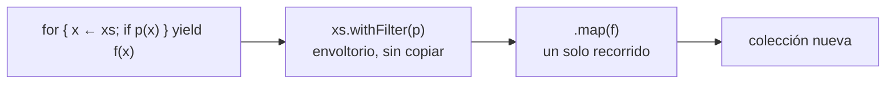
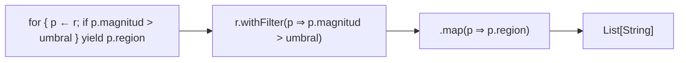
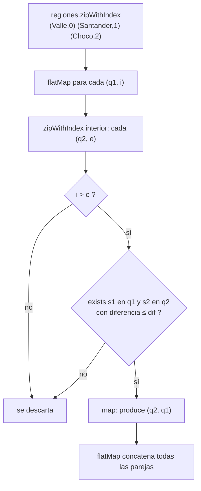
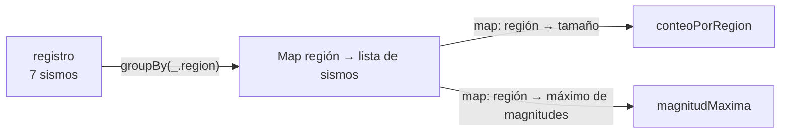
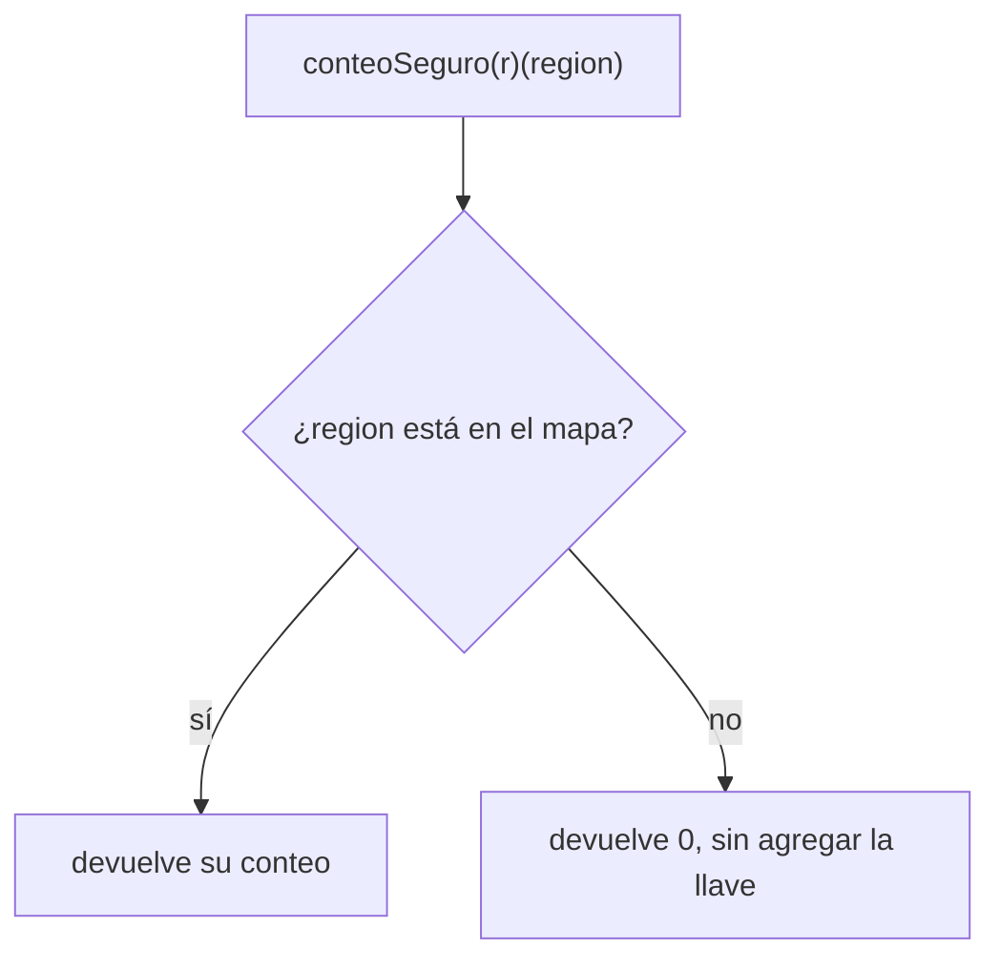
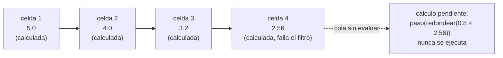
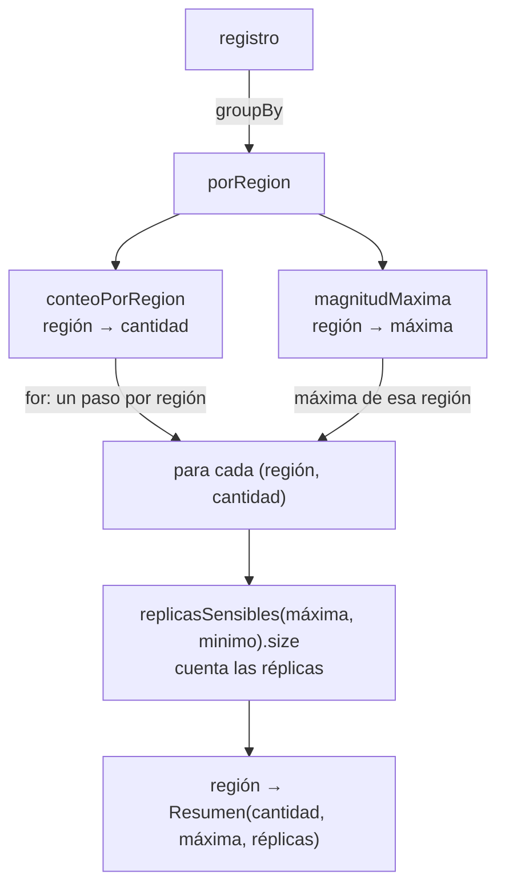

# Informe de proceso — Taller 3: registro sísmico

Este informe explica cómo se ejecuta cada función del taller paso a paso. Incluye dos explicaciones que pide el enunciado:

- **En qué operaciones se traduce cada expresión `for`** que se usó (sección 1 y puntos 1 y 5).
- **Por qué la secuencia perezosa del punto 4 no agota la memoria** aunque sea infinita (sección 5.3).

## Contenido

0. [Modelo de datos y ejemplo](#0-modelo-de-datos-y-ejemplo)
1. [Cómo traduce Scala una expresión `for`](#1-cómo-traduce-scala-una-expresión-for)
2. [Punto 1: consultas con expresiones `for`](#2-punto-1-consultas-con-expresiones-for)
3. [Punto 2: agrupar con mapas](#3-punto-2-agrupar-con-mapas)
4. [Punto 3: consultas seguras](#4-punto-3-consultas-seguras)
5. [Punto 4: réplicas perezosas](#5-punto-4-réplicas-perezosas)
6. [Punto 5: informe combinado](#6-punto-5-informe-combinado)
7. [Resumen](#7-resumen)

---

## 0. Modelo de datos y ejemplo

### Los tipos

```scala
case class Fecha(anio: Int, mes: Int)
case class Sismo(fecha: Fecha, region: String, magnitud: Double, profundidad: Int)
type Registro = List[Sismo]
case class Resumen(sismos: Int, maxima: Double, replicas: Int)
```

### El registro de ejemplo

Las trazas del informe usan el registro del enunciado. Cada sismo se nombra $s_1,\dots,s_7$ según su posición en la lista:

| Sismo | Fecha | Región | Magnitud | Profundidad |
|---|---|---|---|---|
| $s_1$ | 2025-03 | Valle | 4.2 | 30 |
| $s_2$ | 2025-03 | Santander | 5.1 | 150 |
| $s_3$ | 2025-04 | Valle | 3.8 | 25 |
| $s_4$ | 2025-04 | Choco | 6.0 | 40 |
| $s_5$ | 2025-05 | Santander | 4.7 | 160 |
| $s_6$ | 2025-05 | Valle | 5.3 | 35 |
| $s_7$ | 2025-06 | Choco | 3.1 | 20 |

Agrupado por región, queda:

| Región | Sismos | Magnitudes |
|---|---|---|
| Valle | $s_1,s_3,s_6$ | 4.2, 3.8, 5.3 |
| Santander | $s_2,s_5$ | 5.1, 4.7 |
| Choco | $s_4,s_7$ | 6.0, 3.1 |

---

## 1. Cómo traduce Scala una expresión `for`

Una expresión `for ... yield` **no es un ciclo**: es azúcar sintáctico. El compilador la reescribe como llamadas encadenadas a `withFilter`, `map` y `flatMap`. Las reglas que usan los cuatro `for` del taller son:

| Forma del `for` | Se traduce a |
|---|---|
| `for (x <- xs) yield e` | `xs.map(x => e)` |
| `for (x <- xs if p) yield e` | `xs.withFilter(x => p).map(x => e)` |
| `for (x <- xs; y <- ys) yield e` | `xs.flatMap(x => ys.map(y => e))` |
| `for (x <- xs; if p; y <- ys) yield e` | `xs.withFilter(x => p).flatMap(x => ys.map(y => e))` |
| `for (x <- xs; y = e1) yield e2` | `xs.map { x => val y = e1; ... }` con `y` disponible en el resto |
| generador con patrón `(a, b) <- xs` | el cuerpo es `{ case (a, b) => ... }` |

En notación matemática, la regla del filtro es:

$$
\texttt{for}\ \lbrace\ x\leftarrow xs;\ \texttt{if}\ p(x)\ \rbrace\ \texttt{yield}\ f(x)\ \equiv\ xs.\texttt{withFilter}(p).\texttt{map}(f)
$$

y la de dos generadores anidados:

$$
\texttt{for}\ \lbrace\ x\leftarrow xs;\ y\leftarrow ys\ \rbrace\ \texttt{yield}\ f(x,y)\ \equiv\ xs.\texttt{flatMap}\big(x\Rightarrow ys.\texttt{map}(y\Rightarrow f(x,y))\big)
$$

### Qué hace cada operación

| Operación | Qué hace |
|---|---|
| `withFilter(p)` | **No crea una lista intermedia**: devuelve un envoltorio que recuerda el filtro `p` y lo aplica cuando llega el `map` o el `flatMap` siguiente. Así se hace un solo recorrido. |
| `map(f)` | Recorre la colección una vez, aplica `f` a cada elemento y construye una colección nueva con los resultados. |
| `flatMap(f)` | Como `map`, pero `f` devuelve una colección por cada elemento, y todas se **concatenan** en una sola. Es el que permite anidar generadores. |

Los patrones de tupla, como `(q1, i) <- ...`, pueden hacer que el compilador (según la versión de Scala) añada un `withFilter { case (_, _) => true; case _ => false }`. Es un filtro que siempre acepta, así que no cambia el resultado y no se escribe en las traducciones de este informe.



El taller usa **cuatro** expresiones `for`: `fuertes`, `enRegion`, `paresCercanos` e `informe`. Cada una se traduce en su sección.

---

## 2. Punto 1: consultas con expresiones `for`

### 2.1 `fuertes`

**Código:**

```scala
for {
  p <- r
  if (p.magnitud > umbral)
} yield (p.region)
```

**Traducción del compilador** (un generador con un guard):

```scala
r.withFilter(p => p.magnitud > umbral)
 .map(p => p.region)
```



**Cómo se ejecuta:**

1. `withFilter` registra la condición `p.magnitud > umbral`; todavía no recorre nada.
2. `map` recorre `r` una sola vez, **en orden**. Para cada sismo evalúa la condición: si es cierta, aplica `p.region` y agrega el resultado al final de la lista nueva; si no, lo salta.
3. Como no hay `distinct`, las regiones repetidas se conservan.

**Traza: `fuertes(registro, 5.0)`**

| Paso | Sismo | Región | Magnitud | ¿`magnitud > 5.0`? | Lista de resultado |
|---|---|---|---|---|---|
| 1 | $s_1$ | Valle | 4.2 | no | `List()` |
| 2 | $s_2$ | Santander | 5.1 | **sí** | `List(Santander)` |
| 3 | $s_3$ | Valle | 3.8 | no | `List(Santander)` |
| 4 | $s_4$ | Choco | 6.0 | **sí** | `List(Santander, Choco)` |
| 5 | $s_5$ | Santander | 4.7 | no | `List(Santander, Choco)` |
| 6 | $s_6$ | Valle | 5.3 | **sí** | `List(Santander, Choco, Valle)` |
| 7 | $s_7$ | Choco | 3.1 | no | `List(Santander, Choco, Valle)` |

**Resultado:** `List("Santander", "Choco", "Valle")`.

**Casos especiales:**

| Llamada | Qué ocurre | Resultado |
|---|---|---|
| `fuertes(registro, 6.0)` | `6.0 > 6.0` es falso: el umbral es **estricto** | `List()` |
| `fuertes(registro, 9.0)` | Ningún sismo pasa el filtro | `List()` |
| `fuertes(registro, 3.0)` | Pasan los 7 sismos, con repetidos | lista de longitud 7 |
| `fuertes(registro, -1.0)` | Pasan todos | lista de longitud 7 |
| `fuertes(List(), 5.0)` | `map` sobre una lista vacía | `List()` |

### 2.2 `enRegion`

**Código:**

```scala
for {
  q <- r
  if (q.region == region)
} yield (q.magnitud)
```

**Traducción:**

```scala
r.withFilter(q => q.region == region)
 .map(q => q.magnitud)
```

Es la misma forma que `fuertes`: un generador, un filtro y un `map`; cambia la condición (igualdad de región) y lo que se extrae (la magnitud).

**Traza: `enRegion(registro, "Valle")`**

| Paso | Sismo | Región | ¿`region == "Valle"`? | Magnitud agregada | Lista de resultado |
|---|---|---|---|---|---|
| 1 | $s_1$ | Valle | **sí** | 4.2 | `List(4.2)` |
| 2 | $s_2$ | Santander | no | — | `List(4.2)` |
| 3 | $s_3$ | Valle | **sí** | 3.8 | `List(4.2, 3.8)` |
| 4 | $s_4$ | Choco | no | — | `List(4.2, 3.8)` |
| 5 | $s_5$ | Santander | no | — | `List(4.2, 3.8)` |
| 6 | $s_6$ | Valle | **sí** | 5.3 | `List(4.2, 3.8, 5.3)` |
| 7 | $s_7$ | Choco | no | — | `List(4.2, 3.8, 5.3)` |

**Resultado:** `List(4.2, 3.8, 5.3)`, en el orden del registro.

**Casos especiales:** `enRegion(registro, "Amazonas")` no deja pasar ningún sismo y da `List()`. Sobre el registro vacío también da `List()`. La comparación `==` distingue mayúsculas, así que `"valle"` no coincide con `"Valle"`.

### 2.3 `paresCercanos`

**Código:**

```scala
val regiones = r.map(_.region).distinct
for {
  (q1, i) <- regiones.zipWithIndex
  (q2, e) <- regiones.zipWithIndex
  if (i > e)
  if r.exists(s1 =>
       s1.region == q1 &&
       r.exists(s2 => s2.region == q2 && math.abs(s1.magnitud - s2.magnitud) <= dif))
} yield (q2, q1)
```

**Cómo se ejecuta, paso a paso:**

1. **Regiones únicas, en orden de primera aparición.** `r.map(_.region)` da las regiones de los 7 sismos y `distinct` conserva la primera aparición de cada una.
2. **Índices.** `zipWithIndex` pega a cada región su posición: así se puede comparar quién apareció antes.
3. **Doble generador.** Se recorren todas las parejas $(q_1,q_2)$ de regiones, con sus índices $(i,e)$.
4. **Primer guard `i > e`.** Deja pasar sólo las parejas donde $q_2$ apareció **antes** que $q_1$. Esto hace dos cosas: descarta una región emparejada consigo misma ($i=e$) y deja **una sola** de las dos órdenes posibles de cada pareja.
5. **Segundo guard (`exists` anidado).** Comprueba que exista un sismo $s_1$ de $q_1$ y un sismo $s_2$ de $q_2$ con $\lvert m_1-m_2\rvert\le dif$:

$$\exists\, s_1,s_2\in r:\ \ s_1.\text{region}=q_1\ \wedge\ s_2.\text{region}=q_2\ \wedge\ \lvert s_1.\text{magnitud}-s_2.\text{magnitud}\rvert\le dif$$

   `exists` se detiene en cuanto encuentra un caso, y el `&&` no evalúa la comparación de magnitudes si la región no coincide.
6. **`yield (q2, q1)`.** La pareja se produce con la región **más antigua primero**: `(q2, q1)`.

**Traducción del compilador:**

```scala
regiones.zipWithIndex.flatMap { case (q1, i) =>
  regiones.zipWithIndex
    .withFilter { case (q2, e) => i > e }
    .withFilter { case (q2, e) => r.exists(s1 => /* ... */) }
    .map { case (q2, e) => (q2, q1) }
}
```

El `for` pasa de dos generadores a un `flatMap` exterior con un `map` interior (la regla de generadores anidados), y cada `if` pasa a un `withFilter`. Los dos `withFilter` encadenados se aplican en orden: el `exists`, que es el caro, sólo se evalúa para las parejas que ya pasaron `i > e`.



**Paso 1 de la traza:** `regiones`

| Operación | Resultado |
|---|---|
| `r.map(_.region)` | `List(Valle, Santander, Valle, Choco, Santander, Valle, Choco)` |
| `.distinct` | `List(Valle, Santander, Choco)` |
| `.zipWithIndex` | `List((Valle,0), (Santander,1), (Choco,2))` |

**Diferencia mínima entre los sismos de cada pareja de regiones** (es lo que decide el `exists`):

| Pareja | Pares de magnitudes más cercanos | Diferencia mínima |
|---|---|---|
| Valle y Santander | 5.3 y 5.1 | 0.2 |
| Valle y Choco | 5.3 y 6.0 (y también 3.8 y 3.1) | 0.7 |
| Santander y Choco | 5.1 y 6.0 | 0.9 |

La pareja sale si y sólo si su diferencia mínima es $\le dif$.

**Traza: `paresCercanos(registro, 0.6)`** (los nueve pares $(q_1,q_2)$ del doble generador):

| $(q_1, i)$ | $(q_2, e)$ | ¿`i > e`? | `exists` con $dif=0.6$ | Resultado |
|---|---|---|---|---|
| (Valle, 0) | (Valle, 0) | no | no se evalúa | — |
| (Valle, 0) | (Santander, 1) | no | no se evalúa | — |
| (Valle, 0) | (Choco, 2) | no | no se evalúa | — |
| (Santander, 1) | (Valle, 0) | **sí** | $0.2\le 0.6$: **sí** | **(Valle, Santander)** |
| (Santander, 1) | (Santander, 1) | no | no se evalúa | — |
| (Santander, 1) | (Choco, 2) | no | no se evalúa | — |
| (Choco, 2) | (Valle, 0) | **sí** | $0.7\le 0.6$: no | — |
| (Choco, 2) | (Santander, 1) | **sí** | $0.9\le 0.6$: no | — |
| (Choco, 2) | (Choco, 2) | no | no se evalúa | — |

**Resultado:** `List(("Valle", "Santander"))`. Con el guard `i > e` sólo 3 de los 9 pares llegan al `exists`.

**Otros valores de `dif`** (mismas tres parejas candidatas, en el orden en que el generador las recorre):

| `dif` | Valle–Santander (0.2) | Valle–Choco (0.7) | Santander–Choco (0.9) | Resultado |
|---|---|---|---|---|
| 0.1 | no | no | no | `List()` |
| 0.6 | **sí** | no | no | `List((Valle,Santander))` |
| 1.0 | **sí** | **sí** | **sí** | `List((Valle,Santander), (Valle,Choco), (Santander,Choco))` |

El orden del resultado con $dif=1.0$ sale del orden de recorrido: el generador exterior va por $q_1$ (Santander, luego Choco) y el interior por $q_2$ (Valle, luego Santander).

**Casos especiales:**

| Caso | Qué ocurre | Resultado |
|---|---|---|
| `dif` negativa | $\lvert\cdot\rvert\le dif$ nunca es cierto | `List()` |
| Registro vacío | `regiones` es vacía, el `flatMap` no produce nada | `List()` |
| Una sola región | Todas las parejas tienen $i=e$ y el guard las descarta | `List()` |
| Dos sismos de la misma región con magnitudes cercanas | Nunca se compara una región consigo misma | `List()` |
| Diferencia exactamente igual a `dif` | El criterio es $\le$, así que **entra** | la pareja aparece |

---

## 3. Punto 2: agrupar con mapas

Este punto no usa `for`: usa `groupBy` y `map` sobre mapas, que es lo que pide el criterio de rúbrica ("usa mapas para los agrupamientos, no listas recorridas a mano").

### 3.1 `porRegion`

**Código:** `r.groupBy(_.region)`.

**Cómo se ejecuta.** `groupBy(f)` recorre la lista **una sola vez, en orden**: para cada sismo calcula la llave `f(sismo)` y lo agrega, **al final**, a la lista de esa llave. Al terminar entrega un `Map` inmutable. En notación matemática:

$$\texttt{groupBy}(f)(xs)=\lbrace\ k\mapsto[\,x\in xs\mid f(x)=k\,]\ \rbrace$$

donde cada lista conserva el **orden original** de $xs$.

**Traza: `porRegion(registro)`**

| Paso | Sismo | Llave (región) | Grupo después de agregarlo |
|---|---|---|---|
| 1 | $s_1$ | Valle | Valle → $[s_1]$ |
| 2 | $s_2$ | Santander | Santander → $[s_2]$ |
| 3 | $s_3$ | Valle | Valle → $[s_1,s_3]$ |
| 4 | $s_4$ | Choco | Choco → $[s_4]$ |
| 5 | $s_5$ | Santander | Santander → $[s_2,s_5]$ |
| 6 | $s_6$ | Valle | Valle → $[s_1,s_3,s_6]$ |
| 7 | $s_7$ | Choco | Choco → $[s_4,s_7]$ |

**Resultado:** `Map(Valle -> List(s1, s3, s6), Santander -> List(s2, s5), Choco -> List(s4, s7))`.

Sólo aparecen las regiones que están en el registro: `groupBy` crea un grupo cuando ve la primera llave, así que **nunca crea un grupo vacío**. Sobre el registro vacío da `Map()`.



### 3.2 `conteoPorRegion`

**Código:**

```scala
porRegion(r).map { case (region, sismo) => region -> sismo.size }
```

**Cómo se ejecuta.**

1. `porRegion(r)` arma el mapa de la sección anterior.
2. `map` sobre un `Map` recibe cada pareja `(llave, valor)`; la función devuelve una **nueva pareja** `(region, cantidad)`, y por eso el resultado vuelve a ser un `Map`.
3. `sismo.size` es el número de elementos de la lista de esa región.

| Entrada del mapa | Cálculo | Salida |
|---|---|---|
| Valle → $[s_1,s_3,s_6]$ | `size` = 3 | Valle → 3 |
| Santander → $[s_2,s_5]$ | `size` = 2 | Santander → 2 |
| Choco → $[s_4,s_7]$ | `size` = 2 | Choco → 2 |

**Resultado:** `Map(Valle -> 3, Santander -> 2, Choco -> 2)`. La suma de los valores es 7, el tamaño del registro. Sobre el registro vacío: `Map()`.

### 3.3 `magnitudMaxima`

**Código:**

```scala
porRegion(r).map { case (region, sismo) => region -> sismo.map(_.magnitud).max }
```

**Cómo se ejecuta.** Para cada región, `sismo.map(_.magnitud)` saca la lista de magnitudes y `max` toma la mayor. `max` falla sobre una lista vacía, pero aquí **nunca ocurre** porque `groupBy` no crea grupos vacíos.

| Entrada del mapa | Magnitudes | `max` | Salida |
|---|---|---|---|
| Valle | `List(4.2, 3.8, 5.3)` | 5.3 | Valle → 5.3 |
| Santander | `List(5.1, 4.7)` | 5.1 | Santander → 5.1 |
| Choco | `List(6.0, 3.1)` | 6.0 | Choco → 6.0 |

**Resultado:** `Map(Valle -> 5.3, Santander -> 5.1, Choco -> 6.0)`. No importa el orden de los sismos dentro del grupo: el máximo es el mismo.

---

## 4. Punto 3: consultas seguras

### 4.1 `conteoSeguro`

**Código:** `conteoPorRegion(r).withDefaultValue(0)`.

**Cómo se ejecuta.** `withDefaultValue(0)` **envuelve** el mapa en uno nuevo que se comporta igual, salvo en `apply`: si la llave no está, en lugar de lanzar una excepción devuelve el valor por defecto. **No agrega la llave al mapa**: `contains` sigue dando `false`.



| Llamada | Qué ocurre | Resultado |
|---|---|---|
| `conteoSeguro(registro)("Valle")` | La llave está: devuelve su valor | 3 |
| `conteoSeguro(registro)("Santander")` | La llave está | 2 |
| `conteoSeguro(registro)("Amazonas")` | La llave **no** está: usa el valor por defecto | 0 |
| `conteoSeguro(registro)("valle")` | Distingue mayúsculas: no está | 0 |
| `conteoSeguro(List())("Valle")` | El mapa es vacío: todo da el valor por defecto | 0 |

### 4.2 `maximaDe`

**Código:** `magnitudMaxima(r).get(region)`.

**Cómo se ejecuta.** `get` busca la llave en el mapa y devuelve un `Option[Double]` en lugar de lanzar excepción: `Some(valor)` si la llave existe y `None` si no.

| Llamada | Búsqueda en `Map(Valle -> 5.3, Santander -> 5.1, Choco -> 6.0)` | Resultado |
|---|---|---|
| `maximaDe(registro, "Choco")` | Encuentra 6.0 | `Some(6.0)` |
| `maximaDe(registro, "Valle")` | Encuentra 5.3 | `Some(5.3)` |
| `maximaDe(registro, "Amazonas")` | No encuentra la llave | `None` |
| `maximaDe(List(), "Valle")` | El mapa es vacío | `None` |

### 4.3 `regionMasActiva`

**Código:**

```scala
val conteoByregion = conteoPorRegion(r)
if (conteoByregion.isEmpty) None
else Some(conteoByregion.minBy { case (region, cantidad) => (-cantidad, region) }._1)
```

**Cómo se ejecuta:**

1. Se calcula el conteo por región.
2. Si el mapa está vacío, el resultado es `None` (no hay región que devolver). Si no, se sigue.
3. `minBy` busca la pareja de **clave mínima**, donde la clave es $\big(-\text{cantidad},\ \text{región}\big)$, comparada **lexicográficamente**: primero el número negado y, en empate, la región como texto.
4. Se niega la cantidad porque `minBy` busca el menor: el menor de $-\text{cantidad}$ es el de **mayor** cantidad. En empate, el texto menor es el primero en orden alfabético.
5. `._1` toma el nombre de la región y `Some(...)` lo envuelve.

**Traza: `regionMasActiva(registro)`**

| Región | Cantidad | Clave $(-\text{cantidad},\ \text{región})$ |
|---|---|---|
| Valle | 3 | $(-3,\ \text{Valle})$ |
| Santander | 2 | $(-2,\ \text{Santander})$ |
| Choco | 2 | $(-2,\ \text{Choco})$ |

La clave mínima es $(-3,\ \text{Valle})$ porque $-3<-2$. **Resultado:** `Some("Valle")`.

**Casos con empate y otros:**

| Caso | Claves | Resultado |
|---|---|---|
| Zulia: 1 sismo, Arauca: 1 sismo | $(-1,\text{Zulia})$ y $(-1,\text{Arauca})$: empatan en la primera componente y `"Arauca"` < `"Zulia"` | `Some("Arauca")` |
| C, B y A con 1 sismo cada una | $(-1,\text{C})$, $(-1,\text{B})$, $(-1,\text{A})$: gana A | `Some("A")` |
| Z con 2 sismos y A con 1 | $(-2,\text{Z})<(-1,\text{A})$: gana por cantidad | `Some("Z")` |
| Una sola región | Es la única clave | `Some(esa región)` |
| Registro vacío | El mapa es vacío | `None` |

---

## 5. Punto 4: réplicas perezosas

### 5.1 `replicas`

**Código:**

```scala
def replicas(magnitud: Double): LazyList[Double] = {
  def redondear(x: Double): Double = Math.round(x * 100.0) / 100.0
  def paso(m: Double): LazyList[Double] =
    redondear(m) #:: paso(redondear(0.8 * m))
  paso(magnitud)
}
```

**Cómo se ejecuta.**

1. `paso(m)` construye una celda de `LazyList` con el operador `#::`. Sus dos argumentos son **por nombre**: ni la cabeza (`redondear(m)`) ni la cola (`paso(redondear(0.8 * m))`) se calculan al construir la celda; quedan guardadas como cálculos pendientes.
2. Cuando alguien **pide** la cabeza o la cola, ese cálculo se hace **una sola vez** y su resultado se **memoriza** en la celda.
3. La llamada recursiva `paso(...)` está **dentro de la cola pendiente**, así que la función no se llama a sí misma al construir: `replicas(m)` termina de inmediato aunque la secuencia sea infinita.
4. Cada valor se obtiene del anterior: $m_{k+1}=\operatorname{redondear}(0.8\cdot m_k)$, con $\operatorname{redondear}(x)=\dfrac{\text{round}(100\,x)}{100}$.

**Traza: `replicas(5.0).take(4).toList`**

| Celda | Cabeza | Cálculo | Cola |
|---|---|---|---|
| 1 | 5.0 | `redondear(5.0)` | pendiente: `paso(redondear(0.8 * 5.0))` |
| 2 | 4.0 | $0.8\cdot 5.0=4.0$ → `redondear` → 4.0 | pendiente |
| 3 | 3.2 | $0.8\cdot 4.0=3.2$ → 3.2 | pendiente |
| 4 | 2.56 | $0.8\cdot 3.2=2.5600000000000005$ → `redondear` → **2.56** | no se pide |

Aquí se ve para qué sirve el redondeo: sin él, el cuarto valor sería `2.5600000000000005`. `take(4)` pide sólo cuatro elementos y `toList` los materializa. **Resultado:** `List(5.0, 4.0, 3.2, 2.56)`.

**Valores siguientes de `replicas(5.0)`** (sólo se calculan si se piden): 2.05 ($0.8\cdot2.56=2.048$), 1.64, 1.31, 1.05, 0.84, 0.67, … Con el redondeo, la secuencia termina estancándose en 0.02 (porque $0.8\cdot 0.02=0.016$ se redondea de vuelta a 0.02), pero **nunca termina**: siempre produce un siguiente elemento.

**Casos especiales:** `replicas(0.0).take(3)` da `List(0.0, 0.0, 0.0)` (0.8 por 0 es 0). `replicas(7.3).head` es 7.3, la magnitud dada. `replicas(5.0).take(200).toList` tiene 200 elementos y no se cuelga.

### 5.2 `replicasSensibles`

**Código:**

```scala
replicas(magnitud).takeWhile(_ > minimo).toList
```

**Cómo se ejecuta.** `takeWhile(p)` va pidiendo elementos de la `LazyList` uno por uno, **en orden**. Para cada uno evalúa `p`: si es cierto lo conserva y sigue; en cuanto uno **falla**, se detiene y **no vuelve a mirar la cola**. `toList` fuerza ese recorrido y arma la lista final.

**Traza: `replicasSensibles(5.0, 3.0)`**

| Paso | Elemento pedido | ¿`> 3.0`? | Acción |
|---|---|---|---|
| 1 | 5.0 | sí | se conserva; se pide el siguiente |
| 2 | 4.0 | sí | se conserva; se pide el siguiente |
| 3 | 3.2 | sí | se conserva; se pide el siguiente |
| 4 | 2.56 | **no** | **se detiene**: no se calcula una quinta celda |

**Resultado:** `List(5.0, 4.0, 3.2)`. Se calcularon **4** elementos, 3 conservados más el que hizo fallar la condición.

**Otros casos:**

| Llamada | Elementos calculados | Resultado |
|---|---|---|
| `replicasSensibles(2.0, 3.0)` | 1 (2.0 no supera 3.0) | `List()` |
| `replicasSensibles(3.0, 3.0)` | 1 (el mínimo es **estricto**: 3.0 > 3.0 es falso) | `List()` |
| `replicasSensibles(4.0, 3.2)` | 2 (4.0 sí; 3.2 no es mayor que 3.2) | `List(4.0)` |
| `replicasSensibles(5.0, 2.56)` | 4 (5.0, 4.0, 3.2 sí; 2.56 no es mayor que 2.56) | `List(5.0, 4.0, 3.2)` |
| `replicasSensibles(5.0, 2.55)` | 5 (2.56 sí; 2.05 no) | `List(5.0, 4.0, 3.2, 2.56)` |
| `replicasSensibles(5.0, 4.5)` | 2 (5.0 sí; 4.0 no) | `List(5.0)` |

### 5.3 Por qué la secuencia infinita no agota la memoria



La secuencia es infinita en la **definición**, pero en memoria sólo existen las celdas que alguien pidió:

1. **Cada celda es perezosa.** `#::` recibe sus argumentos por nombre: guarda *cómo* calcular la cabeza y la cola, no su valor. Lo que no se pide no se calcula.
2. **La recursión no se desarrolla sola.** La llamada a `paso` vive dentro de la cola pendiente. Construir `replicas(m)` cuesta un paso, no infinitos. Si fuera una `List` (estricta), construirla exigiría calcular todos los elementos antes de devolver algo: el programa no terminaría y la memoria se agotaría.
3. **Sólo se calcula lo que se consume.** `take(k)` pide $k$ elementos y `takeWhile` pide los elementos conservados más uno (el que falla). Después de eso, la cola queda como un cálculo pendiente que nadie ejecuta.
4. **La memoria es proporcional a lo calculado.** Las celdas ya calculadas se **memorizan** (para no recalcular), así que ocupan memoria. Si se calcularon $k$ elementos, la memoria usada es

$$M(k)=\Theta(k)$$

   más una cola pendiente de tamaño constante. La parte infinita que no se pidió **no ocupa memoria**: todavía no existe.
5. **Las celdas ya consumidas se pueden liberar.** En `replicas(magnitud).takeWhile(...).toList`, la `LazyList` no se guarda en una variable, así que las celdas ya recorridas dejan de estar referenciadas y el recolector de basura puede reclamarlas.

La prueba del taller —`replicas(5.0).take(4)` devuelve cuatro elementos sin colgarse— es exactamente esta propiedad: si la definición no fuera perezosa, el programa se quedaría calculando para siempre.

**Precondición sobre el mínimo.** `replicasSensibles` termina porque la secuencia acaba bajando del mínimo. Si el mínimo es muy pequeño (por debajo de 0.02, por ejemplo 0.0 o un valor negativo), la secuencia puede estancarse en un valor que **siempre** lo supera; entonces `takeWhile` nunca encuentra un elemento que falle y `toList` iría acumulando elementos sin fin. Con mínimos realistas, como el 3.0 de las pruebas, termina en pocos pasos.

---

## 6. Punto 5: informe combinado

### Código y traducción del `for`

```scala
val magnitudesMaximas = magnitudMaxima(r)
(for {
  (region, cantidad) <- conteoPorRegion(r)
  maximaMagnitud = magnitudesMaximas(region)
  cantidadRepli  = replicasSensibles(maximaMagnitud, minimo).size
} yield region -> Resumen(cantidad, maximaMagnitud, cantidadRepli)).toMap
```

Este `for` tiene **un generador** (sobre un `Map`, con patrón de tupla) y **dos definiciones de valor** (`=`). Cada definición pasa a ser un `val` dentro del `map`, y el resultado equivale a:

```scala
conteoPorRegion(r).map { case (region, cantidad) =>
  val maximaMagnitud = magnitudesMaximas(region)
  val cantidadRepli  = replicasSensibles(maximaMagnitud, minimo).size
  region -> Resumen(cantidad, maximaMagnitud, cantidadRepli)
}
```

(La traducción real encadena varios `map` auxiliares que pasan las variables en pares anidados; el resultado es el mismo.) Como el `map` sobre un `Map` que devuelve parejas produce un `Map`, el resultado ya es un `Map[String, Resumen]`, y el `.toMap` final no cambia nada.



### Cómo se ejecuta

1. `magnitudesMaximas` calcula el mapa región → máxima.
2. `conteoPorRegion(r)` calcula el mapa región → cantidad y el `for` lo recorre pareja por pareja.
3. Para cada región, busca su máxima en `magnitudesMaximas(region)`. La búsqueda es segura: ambos mapas salen de `porRegion`, así que tienen **las mismas llaves**.
4. Calcula las réplicas sensibles de **esa máxima** y toma su tamaño con `.size`. Sólo se calculan los elementos que hace falta (sección 5.2).
5. `yield` arma la pareja `region -> Resumen(...)`.
6. El orden en que se recorre el mapa no importa: el resultado se compara por contenido.

### Traza: `informe(registro, 3.0)`

| Región | Cantidad | Máxima | Réplicas de la máxima (mientras superen 3.0) | Se detiene en | Cuántas | Resumen |
|---|---|---|---|---|---|---|
| Valle | 3 | 5.3 | 5.3, 4.24, 3.39 | 2.71 | 3 | `Resumen(3, 5.3, 3)` |
| Santander | 2 | 5.1 | 5.1, 4.08, 3.26 | 2.61 | 3 | `Resumen(2, 5.1, 3)` |
| Choco | 2 | 6.0 | 6.0, 4.8, 3.84, 3.07 | 2.46 | 4 | `Resumen(2, 6.0, 4)` |

Cálculo de las réplicas de Choco: $0.8\cdot6.0=4.8$; $0.8\cdot4.8=3.84$; $0.8\cdot3.84=3.072\to3.07$; $0.8\cdot3.07=2.456\to2.46$, que ya no supera 3.0.

**Resultado:**

```scala
Map("Valle"     -> Resumen(3, 5.3, 3),
    "Santander" -> Resumen(2, 5.1, 3),
    "Choco"     -> Resumen(2, 6.0, 4))
```

**Casos especiales:**

| Caso | Qué ocurre | Resultado |
|---|---|---|
| Registro vacío | `conteoPorRegion(List())` es `Map()`; el `for` no tiene nada que recorrer y no calcula réplicas | `Map()` |
| Una región con máxima 2.0 y mínimo 3.0 | `replicasSensibles(2.0, 3.0)` es `List()` | `Resumen(1, 2.0, 0)` |
| Región A con 4.0 (un sismo) y mínimo 3.0 | Réplicas: 4.0, 3.2; luego 2.56 no supera 3.0 | `Resumen(1, 4.0, 2)` |
| Región B con 5.0 y 6.0, mínimo 3.0 | Máxima 6.0 → réplicas 6.0, 4.8, 3.84, 3.07 | `Resumen(2, 6.0, 4)` |

---

## 7. Resumen y observaciones

### Resumen

| Función | Herramienta | En qué se traduce | Costo (con $n$ sismos y $k$ regiones) |
|---|---|---|---|
| `fuertes` | `for` con guard | `withFilter` y `map` | $O(n)$ |
| `enRegion` | `for` con guard | `withFilter` y `map` | $O(n)$ |
| `paresCercanos` | `for` con dos generadores y dos guards | `flatMap`, dos `withFilter` y `map` | $O(k^2\cdot n^2)$ en el peor caso |
| `porRegion` | `groupBy` | un recorrido que arma el mapa | $O(n)$ |
| `conteoPorRegion` | `map` sobre un mapa | `size` por grupo | $O(n)$ |
| `magnitudMaxima` | `map` sobre un mapa | `map(_.magnitud).max` por grupo | $O(n)$ |
| `conteoSeguro` | `withDefaultValue` | envoltorio con valor por defecto | $O(n)$ para armarlo y $O(1)$ por consulta |
| `maximaDe` | `get` | `Option` | $O(n)$ |
| `regionMasActiva` | `minBy` con clave `(-cantidad, región)` | un recorrido del mapa | $O(n+k)$ |
| `replicas` | `LazyList` con `#::` | celdas con cola pendiente | $O(1)$ por elemento pedido |
| `replicasSensibles` | `takeWhile` y `toList` | calcula sólo lo conservado más uno | $O(m)$ con $m$ elementos conservados |
| `informe` | `for` con generador y dos `=` | `map` con dos `val` | $O(n+\sum m_r)$ |


